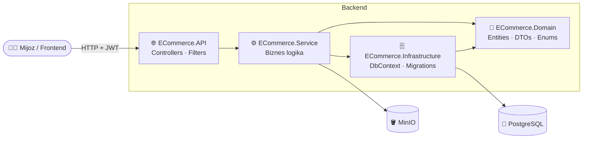
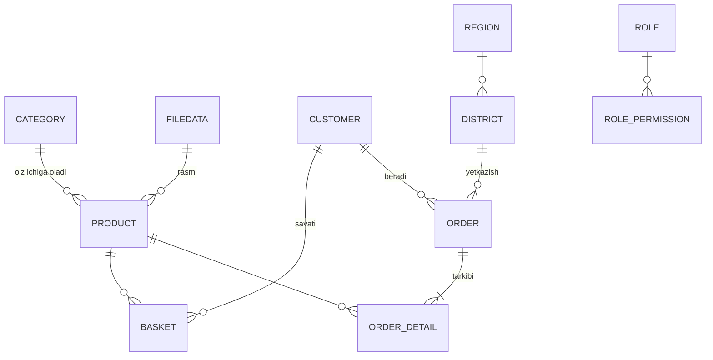
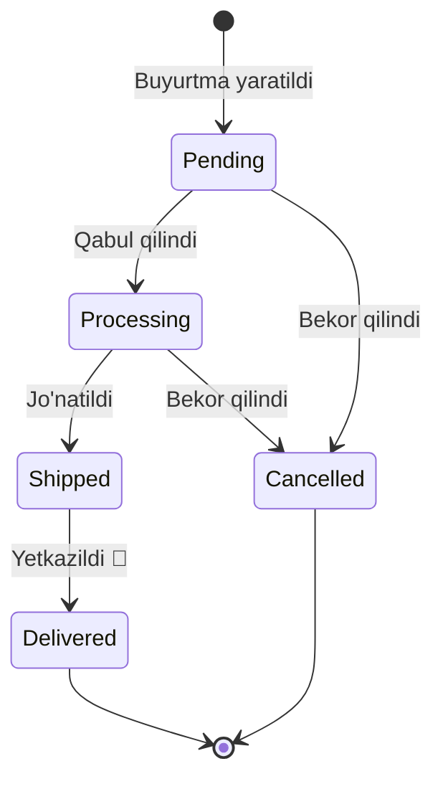
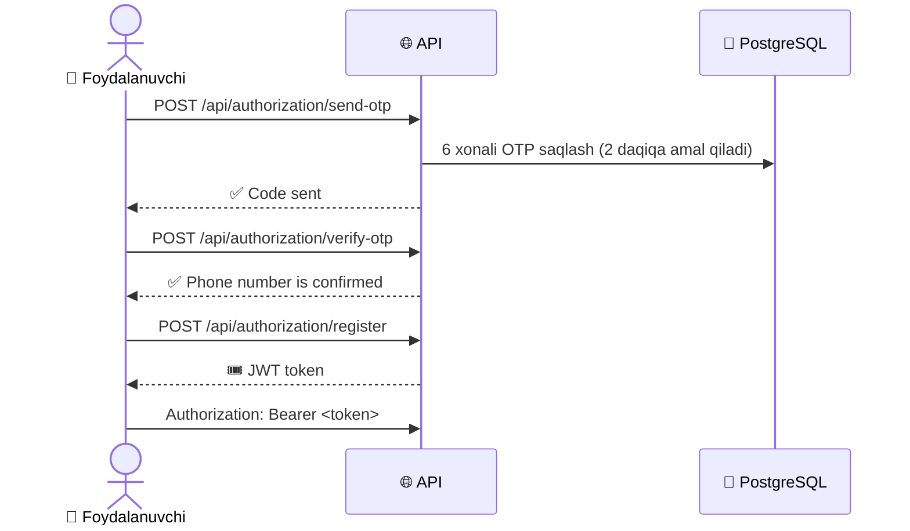

<div align="center">

# 🛒 ECommerce API

### Onlayn do'kon uchun to'liq backend — mahsulotdan buyurtmagacha

*Savatga qo'shing → buyurtma bering → yetkazib berishni kuzating* 📦

<br/>


</div>

---

## 📖 Loyiha haqida

**ECommerce API** — ASP.NET Core 8 asosidagi onlayn do'kon backendi. Unda mahsulotlar katalogi, savat, buyurtmalar, yetkazib berish manzillari, rasm saqlash va **ruxsatlarga asoslangan** (permission-based) avtorizatsiya bor.

> 💡 Har bir endpoint aniq bir ruxsat (`ProductsCreate`, `OrdersEdit`, ...) bilan himoyalangan. Admin rollarni yaratadi va ularga kerakli ruxsatlarni biriktiradi.

---

## ✨ Asosiy imkoniyatlar

<table>
<tr>
<td width="50%" valign="top">

### 🔐 Autentifikatsiya
- 📱 Telefon raqam + **OTP kod** orqali ro'yxatdan o'tish
- 🎟 **JWT** token bilan kirish
- 🧩 ASP.NET Core **Identity**
- 🚫 Foydalanuvchini vaqtincha bloklash / blokdan chiqarish

</td>
<td width="50%" valign="top">

### 🛍 Katalog
- 📦 Mahsulotlar — 🇺🇿 / 🇬🇧 ikki tilda nom va tavsif
- 🗂 Kategoriyalar
- 🔎 Nom bo'yicha qidiruv
- ⚡ `IMemoryCache` bilan keshlash
- 📈 Ombordagi qoldiqni to'ldirish

</td>
</tr>
<tr>
<td width="50%" valign="top">

### 🧺 Savat va buyurtmalar
- ➕ Savatga qo'shish, miqdorni o'zgartirish, tozalash
- 🧾 Buyurtma va uning tafsilotlari
- 💳 To'lov turlari: **Naqd · Click · Payme · Karta**
- 🚚 Buyurtma holatini kuzatish

</td>
<td width="50%" valign="top">

### 🛡 Boshqaruv
- 👥 Rollar va **13 ta ruxsat**
- 🗺 Viloyat va tumanlar (yetkazib berish manzili)
- 🖼 Mahsulot rasmlarini **MinIO** ga yuklash
- 📝 **NLog** orqali loglash

</td>
</tr>
</table>

---

## 🧰 Texnologiyalar

| Qatlam | Texnologiya |
|:--|:--|
| ⚙️ Framework | ASP.NET Core 8 Web API |
| 🗄 Ma'lumotlar bazasi | PostgreSQL + Entity Framework Core 8 (Npgsql) |
| 🔑 Xavfsizlik | ASP.NET Core Identity, JWT Bearer, BCrypt |
| 🖼 Fayl saqlash | MinIO (S3 ga mos) |
| 🔁 Mapping | AutoMapper 12 |
| ⚡ Keshlash | IMemoryCache |
| 📝 Loglash | NLog |
| 📘 Hujjatlar | Swagger / Swashbuckle |
| 🐳 Konteyner | Docker, Docker Compose |

---

## 🏛 Arxitektura



```
ECommerce/
├── 🌐 ECommerce.API/            # Controllerlar, HasPermission filtri, Program.cs, NLog
├── ⚙️ ECommerce.Service/        # Servislar: Auth, JWT, Product, Order, Basket, File ...
├── 🗄 ECommerce.Infrastructure/ # ApplicationDbContext va EF Core migratsiyalari
├── 🧱 ECommerce.Domain/         # Entity, DTO, Enum, ResponseModel, TableOptions
└── 🐳 docker-compose.yaml       # PostgreSQL + MinIO
```

---

## 🗺 Ma'lumotlar modeli



---

## 🚚 Buyurtma hayot sikli



| Status | Qiymat | | To'lov turi | Qiymat |
|:--|:--:|:-:|:--|:--:|
| ⏳ `Pending` | 0 | | 💵 `cash` | 0 |
| 🔧 `Processing` | 1 | | 📲 `click` | 1 |
| 🚛 `Shipped` | 2 | | 📲 `payme` | 2 |
| ✅ `Delivered` | 3 | | 💳 `card` | 3 |
| ❌ `Cancelled` | 4 | | | |

---

## 🔐 Ro'yxatdan o'tish jarayoni



### 🛡 Ruxsatlar (Permissions)

JWT ichidagi `permissions` claim'i `[HasPermission(...)]` filtri orqali tekshiriladi:

| Bo'lim | Ruxsatlar |
|:--|:--|
| 📦 Mahsulotlar | `ProductsView` · `ProductsCreate` · `ProductsEdit` · `ProductsDelete` |
| 🧾 Buyurtmalar | `OrdersView` · `OrdersEdit` · `OrdersCancel` |
| 👥 Foydalanuvchilar | `UsersView` · `UsersUpdate` · `UsersDelete` |
| 🗂 Katalog | `CategoriesManage` |
| 🗺 Manzillar | `AddressesManage` |
| 🔑 Rollar | `RolesManage` |

---

## 🚀 Tezkor start

### 📋 Talablar

- [.NET 8 SDK](https://dotnet.microsoft.com/download/dotnet/8.0)
- [Docker](https://www.docker.com/) — PostgreSQL va MinIO uchun
- *(ixtiyoriy)* EF CLI: `dotnet tool install --global dotnet-ef`

### 1️⃣ Klonlash

```bash
git clone https://github.com/MustafoRavshanov/ECommerce.git
cd ECommerce
```

### 2️⃣ PostgreSQL va MinIO'ni ishga tushirish

```bash
docker compose up -d
```

| Servis | Manzil |
|:--|:--|
| 🐘 PostgreSQL | `localhost:5432` (baza: `ecommerce_db`) |
| 🪣 MinIO API | `localhost:9000` |
| 🖥 MinIO Console | `http://localhost:9001` |

### 3️⃣ Konfiguratsiya

`ECommerce.API/appsettings.Development.json` (yoki User Secrets):

```json
{
  "ConnectionStrings": {
    "DefaultConnection": "Host=localhost;Port=5432;Database=ecommerce_db;Username=postgres;Password=<parol>"
  },
  "JwtSettings": {
    "SecretKey": "<kamida-32-belgili-maxfiy-kalit>",
    "Issuer": "ECommerce",
    "Audience": "ECommerceUsers",
    "ExpiresInHours": 1
  },
  "MinIO": {
    "Endpoint": "localhost:9000",
    "AccessKey": "<minio-user>",
    "SecretKey": "<minio-parol>",
    "BucketName": "product-image"
  },
  "Key": {
    "ApiKey": "<bloklash-uchun-api-kalit>"
  }
}
```

### 4️⃣ Ishga tushirish

```bash
dotnet run --project ECommerce.API
```

> 🪄 Migratsiyalar ilova ishga tushganda **avtomatik** qo'llanadi (`Database.Migrate()`), alohida `dotnet ef database update` shart emas.

### 5️⃣ Swagger'ni ochish 🎉

👉 **http://localhost:5076/swagger**

Himoyalangan endpointlarni sinash uchun **Authorize** 🔒 tugmasini bosing va login'dan olingan tokenni kiriting.

---

## 📡 API endpointlar

<details>
<summary><b>🔐 Authorization</b> — <code>/api/authorization</code></summary>

| Metod | Endpoint | Tavsif |
|:--|:--|:--|
| `POST` | `/send-otp` | Telefon raqamga OTP yuborish |
| `POST` | `/verify-otp` | OTP'ni tasdiqlash |
| `POST` | `/register` | Ro'yxatdan o'tish |
| `POST` | `/login` | Kirish va JWT olish |
| `PUT` | `/block-user` | Foydalanuvchini bloklash (API key bilan) |
| `PUT` | `/unblock-user` | Blokdan chiqarish (API key bilan) |

</details>

<details>
<summary><b>📦 Product</b> — <code>/api/product</code></summary>

| Metod | Endpoint | Ruxsat |
|:--|:--|:--|
| `POST` | `/create` | `ProductsCreate` |
| `GET` | `/get-all` | 🌍 Ochiq |
| `GET` | `/get-all-full` | `ProductsView` |
| `GET` | `/get-by-id/{id}` | 🌍 Ochiq |
| `GET` | `/get-full-by-id/{id}` | `ProductsView` |
| `GET` | `/get-by-name` | 🌍 Ochiq |
| `PUT` | `/update/{id}` | `ProductsEdit` |
| `PUT` | `/add-quantity/{productId}` | `ProductsEdit` |
| `DELETE` | `/delete/{id}` | `ProductsDelete` |

</details>

<details>
<summary><b>🗂 Category</b> — <code>/api/category</code></summary>

| Metod | Endpoint | Ruxsat |
|:--|:--|:--|
| `POST` | `/create` | `CategoriesManage` |
| `GET` | `/get-all` | 🌍 Ochiq |
| `GET` | `/get-all-full` | 🔑 Token |
| `GET` | `/get-by-id/{id}` | 🌍 Ochiq |
| `GET` | `/get-full-by-id/{id}` | 🔑 Token |
| `GET` | `/get-by-name` | 🌍 Ochiq |
| `PUT` | `/update/{id}` | `CategoriesManage` |
| `DELETE` | `/delete/{id}` | `CategoriesManage` |

</details>

<details>
<summary><b>🧺 Basket</b> — <code>/api/basket</code></summary>

| Metod | Endpoint | Tavsif |
|:--|:--|:--|
| `POST` | `/create` | Savatga qo'shish |
| `GET` | `/get-by-customer-id` | Mening savatim |
| `GET` | `/get-basket-by-id/{basketId}` | ID bo'yicha |
| `PUT` | `/update/{basketId}` | Miqdorni o'zgartirish |
| `DELETE` | `/delete/{basketId}` | Savatdan o'chirish |
| `DELETE` | `/clear` | Savatni tozalash |

</details>

<details>
<summary><b>🧾 Order</b> — <code>/api/order</code> va <code>/api/order-detail</code></summary>

| Metod | Endpoint | Ruxsat |
|:--|:--|:--|
| `POST` | `/api/order/create` | 🔑 Token |
| `GET` | `/api/order/get-my-orders` | 🔑 Token |
| `GET` | `/api/order/get-all-full/{customerId}` | `OrdersView` |
| `GET` | `/api/order/get-by-id/{id}` | 🔑 Token |
| `GET` | `/api/order/get-full-by-id/{id}/{customerId}` | `OrdersView` |
| `PUT` | `/api/order/update/{id}` | `OrdersEdit` |
| `DELETE` | `/api/order/delete/{id}` | `OrdersCancel` |
| `GET` | `/api/order-detail/get-by-id/{orderId}` | 🔑 Token |
| `GET` | `/api/order-detail/get-all` | 🔑 Token |

</details>

<details>
<summary><b>👥 User · Customer · Role</b></summary>

| Metod | Endpoint | Ruxsat |
|:--|:--|:--|
| `GET` | `/api/user/get-all-users` | `UsersView` |
| `GET` | `/api/user/get-user-by-id/{id}` | `UsersView` |
| `GET` | `/api/user/get-user-full-by-id/{id}` | `UsersView` |
| `GET` | `/api/user/get-user-by-phone/{phoneNumber}` | `UsersView` |
| `GET` | `/api/user/get-user-full-by-phone/{phoneNumber}` | `UsersView` |
| `PUT` | `/api/user/update-user` | `UsersUpdate` |
| `PUT` | `/api/user/update-Password` | `UsersUpdate` |
| `GET` | `/api/customer/get-all` · `/get-all-full` · `/get-by-id/{id}` · `/get-full-by-id/{id}` | `UsersView` |
| `PUT` | `/api/customer/update` | `UsersUpdate` |
| `DELETE` | `/api/customer/delete/{id}` | `UsersDelete` |
| `POST` | `/api/role/create-role` | `RolesManage` |
| `GET` | `/api/role/get-all-role` · `/get-role-by-id/{id}` | `RolesManage` |
| `PUT` | `/api/role/update-role/{id}` | `RolesManage` |
| `DELETE` | `/api/role/delete-role/{id}` | `RolesManage` |
| `PUT` | `/api/role/give-permission/{roleId}` · `/remove-permission/{roleId}` · `/update-permission/{roleId}` · `/remove-all-permission/{roleId}` | `RolesManage` |

</details>

<details>
<summary><b>🗺 Region · District · 🖼 File</b></summary>

| Metod | Endpoint | Ruxsat |
|:--|:--|:--|
| `POST` | `/api/region/create` | `AddressesManage` |
| `GET` | `/api/region/get-all` · `/get-by-id/{id}` | 🔑 Token |
| `PUT` · `DELETE` | `/api/region/update/{id}` · `/delete/{id}` | `AddressesManage` |
| `POST` | `/api/district/create` | `AddressesManage` |
| `GET` | `/api/district/get-all` · `/get-by-id/{id}` | 🌍 Ochiq |
| `PUT` · `DELETE` | `/api/district/update/{id}` · `/delete/{id}` | `AddressesManage` |
| `POST` | `/api/file/upload` | `ProductsCreate` |
| `GET` | `/api/file/get-by-id/{id}` · `/get-all` | `ProductsCreate` |

</details>

---

## 📦 Javob formati

Barcha javoblar bir xil "qobiq"da qaytadi:

```json
{
  "statusCode": 200,
  "message": "Success",
  "result": { "...": "..." }
}
```

Validatsiya xatosi bo'lsa:

```json
{
  "isSuccess": false,
  "message": "Price must be greater than 0",
  "statusCode": 400
}
```

---

## 🐳 Docker

API image'ini yig'ish:

```bash
docker build -f ECommerce.API/Dockerfile -t ecommerce-api .
docker run -p 8080:8080 ecommerce-api
```

---

## 🛣 Rejalar (Roadmap)

- [ ] 📲 OTP'ni haqiqiy SMS provayder orqali yuborish
- [ ] 💳 Click / Payme to'lov integratsiyasi
- [ ] 🧪 Unit va integration testlar
- [ ] 🔄 Refresh token
- [ ] 📊 Admin uchun statistika

---

<div align="center">

### 👨‍💻 Muallif

**Mustafo Ravshanov**

[](https://github.com/MustafoRavshanov)

⭐ Loyiha yoqqan bo'lsa, **star** bosishni unutmang!

</div>
